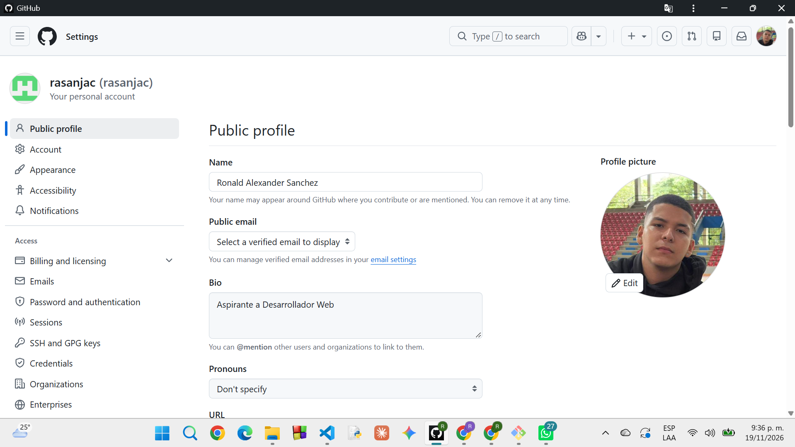

# Hola, soy Ronald Sanchez estoy aprendiendo a programar con un curso de 15 fases 
# Hoy estoy en la fase 0: Git y Github
"Proyecto terminado es proyecto en mi portafolio."
## Lo que estoy aprendiendo
| Tema | Estado | Desde |
|------|--------|-------|
| Git y GitHub | En curso | Nov 2026 |

## Mis metas
- [x] Crear mi bitácora
- [ ] Terminar la fase 0
- [ ] Terminar la fase 2

## Enlaces
- [Mi bitácora](https://github.com/TU-USUARIO/bitacora)
- [Mi plan de estudio](https://rasanjac.github.io/ruta/)

